<div align="center">

# 📊 HR Analytics Dashboard (V2)

### Employee Attrition Analysis | Power BI


**People Insights. Stronger.** 🚀

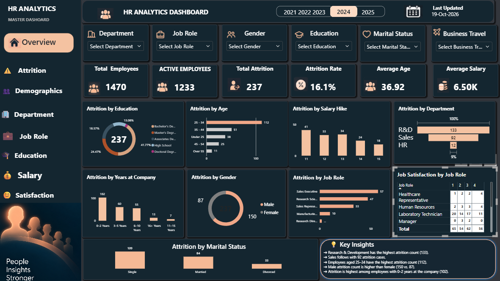

</div>

---

## 📑 Table of Contents
- [🎯 Problem Statement](#-problem-statement)
- [📈 Key Metrics](#-key-metrics)
- [💡 Key Insights](#-key-insights)
- [🗂️ Dashboard Pages](#️-dashboard-pages)
- [📊 Visuals Included](#-visuals-included)
- [🎛️ Filters and Interactivity](#️-filters-and-interactivity)
- [✨ What's New in V2](#-whats-new-in-v2)
- [🖼️ Carousel Preview](#️-carousel-preview)
- [🛠️ Tools Used](#️-tools-used)
- [🗃️ Dataset](#️-dataset)
- [▶️ How to Use](#️-how-to-use)
- [📁 Project Structure](#-project-structure)
- [👤 Author](#-author)

---

## 🎯 Problem Statement
Employee attrition is costly. This dashboard answers questions such as:

- 🔹 How many employees have left, and what is the attrition rate?
- 🔹 Which departments and job roles lose the most people?
- 🔹 Which age groups and tenure bands are most at risk?
- 🔹 How do gender, marital status and education relate to attrition?

---

## 📈 Key Metrics

| 📌 Metric | 🔢 Value |
|:---|:---:|
| 👥 Total Employees | **1,470** |
| ✅ Active Employees | **1,233** |
| 🚪 Total Attrition | **237** |
| 📉 Attrition Rate | **16.1%** |
| 🎂 Average Age | **36.92** |
| 💰 Average Salary | **6.50K** |

---

## 💡 Key Insights

> 🔎 What the data says

1. 🏢 **Research & Development** has the highest attrition count (**133**).
2. 💼 **Sales** follows with **92** attrition cases.
3. 🎂 Employees aged **25–34** have the highest attrition count (**112**).
4. 👨‍💼 **Male** attrition count is higher than female (**150 vs. 87**).
5. ⏳ Attrition is highest among employees with **0–2 years** at the company (**102**).

---

## 🗂️ Dashboard Pages

| | Page |
|:---:|:---|
| 🏠 | Overview |
| ⚠️ | Attrition |
| 👥 | Demographics |
| 🏢 | Department |
| 💼 | Job Role |
| 🎓 | Education |
| 💰 | Salary |
| 😊 | Satisfaction |

---

## 📊 Visuals Included

- 🎓 Attrition by Education
- 🎂 Attrition by Age
- 💸 Attrition by Salary Hike
- 🏢 Attrition by Department
- ⏳ Attrition by Years at Company
- ⚧️ Attrition by Gender
- 💼 Attrition by Job Role
- 💍 Attrition by Marital Status
- 😊 Job Satisfaction by Job Role
- 💡 Key Insights panel

---

## 🎛️ Filters and Interactivity

| Filter | Filter |
|:---|:---|
| 🏢 Department | 💼 Job Role |
| ⚧️ Gender | 🎓 Education |
| 💍 Marital Status | ✈️ Business Travel |
| 📅 Year Selector | 🧭 Page Navigation Menu |

---

## ✨ What's New in V2

| | 🟤 V1 | 🌙 V2 |
|:---|:---|:---|
| 🎨 Theme | Brown theme | Dark navy and peach theme |
| 🧭 Navigation | Single page | Left navigation menu across pages |
| 🎛️ Filters | Department and job role | Six filters plus a year selector |
| 💡 Summary | None | Key Insights panel |
| 📌 KPI cards | Five | Six, including active employees |

<table>
  <tr>
    <th align="center">🟤 Before (V1)</th>
    <th align="center">🌙 After (V2)</th>
  </tr>
  <tr>
    <td>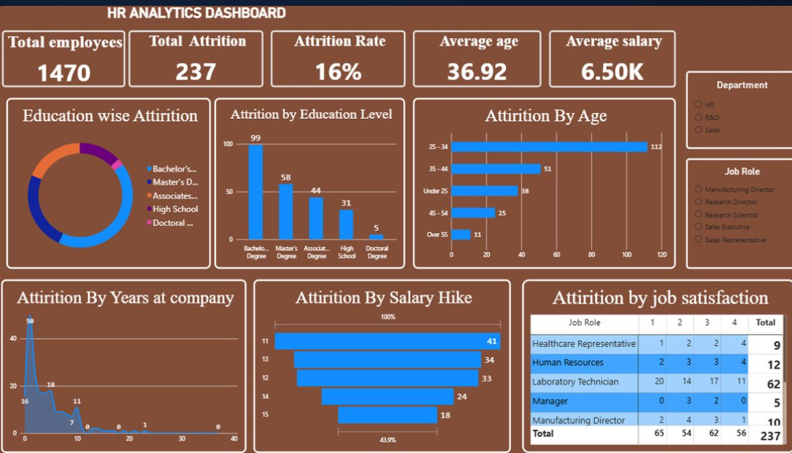</td>
    <td></td>
  </tr>
</table>

---

## 🖼️ Carousel Preview

<table>
  <tr>
    <td>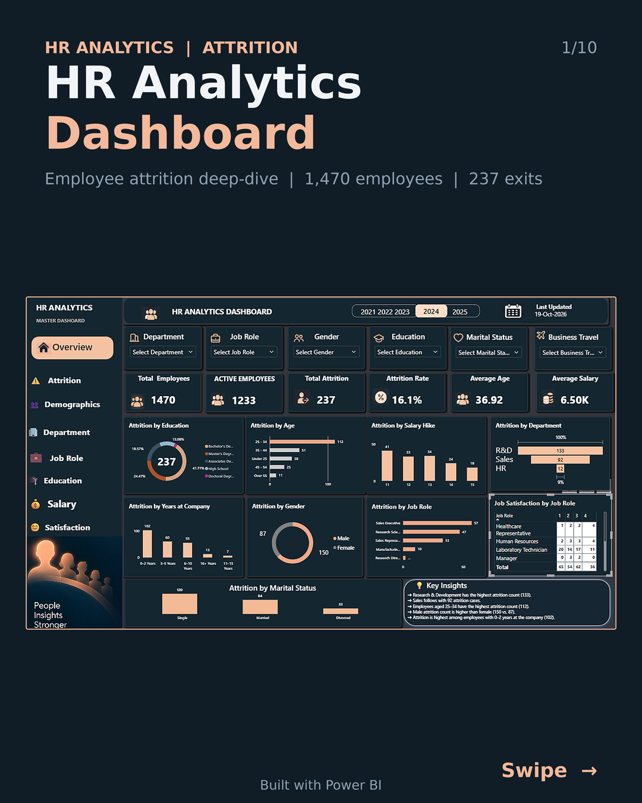</td>
    <td>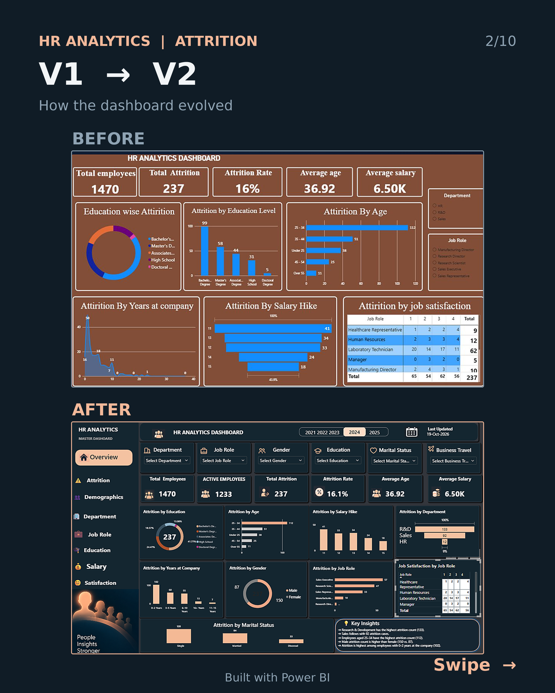</td>
    <td>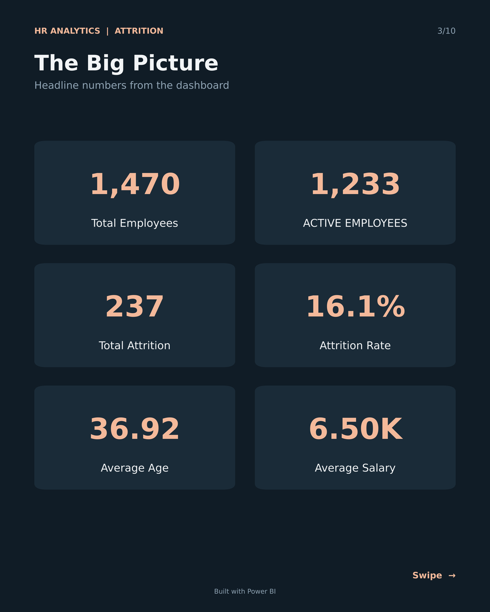</td>
    <td>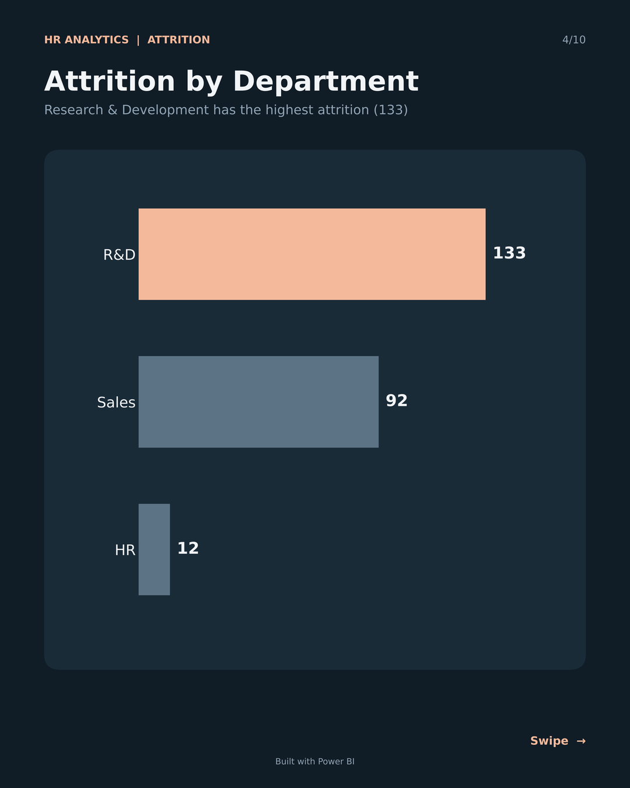</td>
    <td>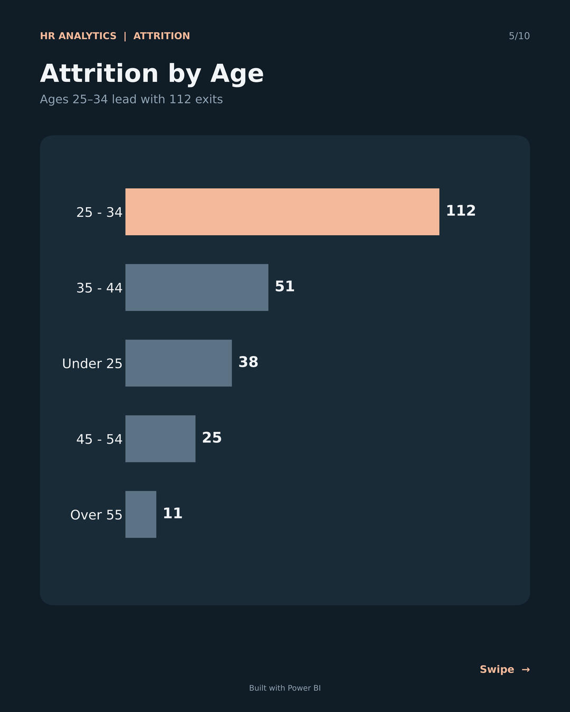</td>
  </tr>
  <tr>
    <td>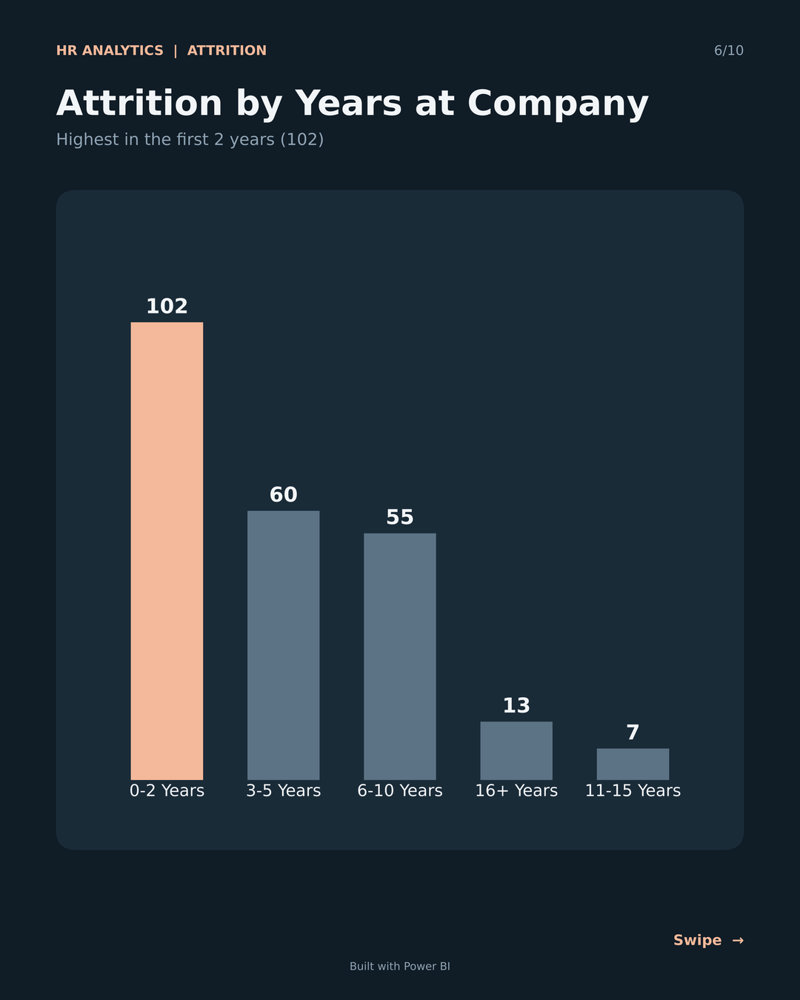</td>
    <td>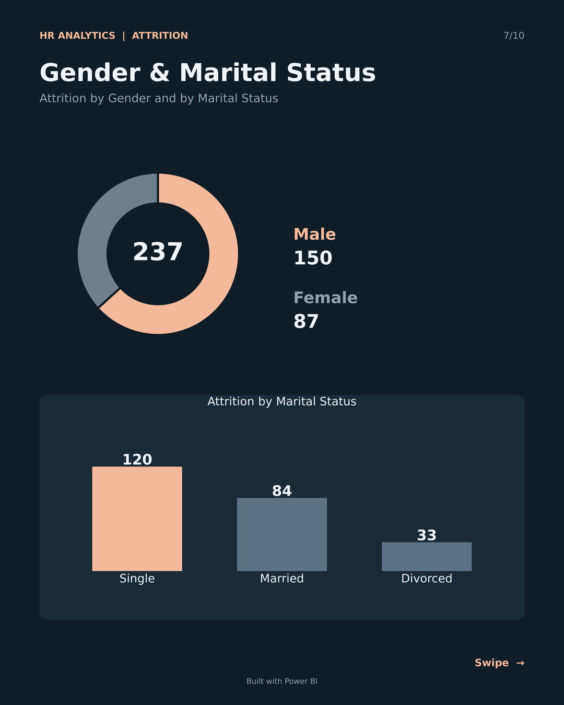</td>
    <td>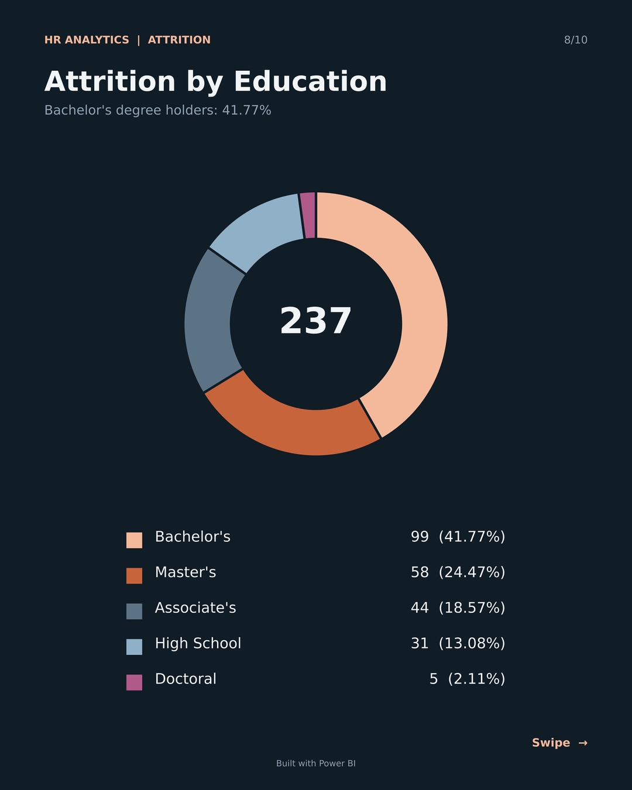</td>
    <td>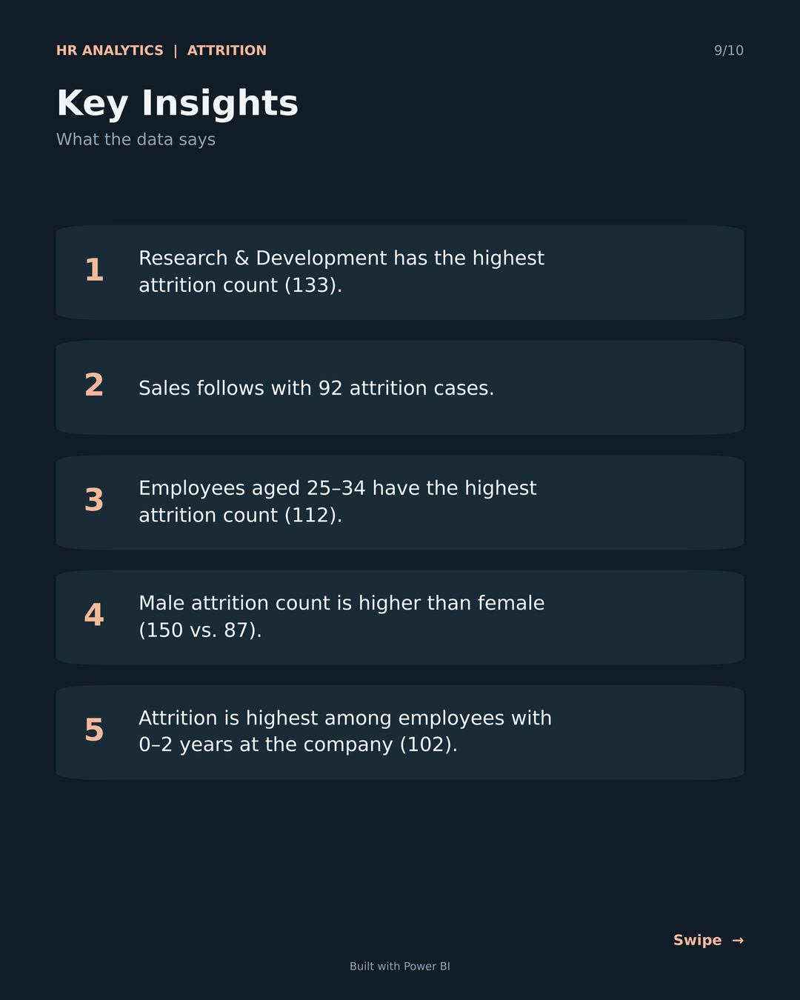</td>
    <td>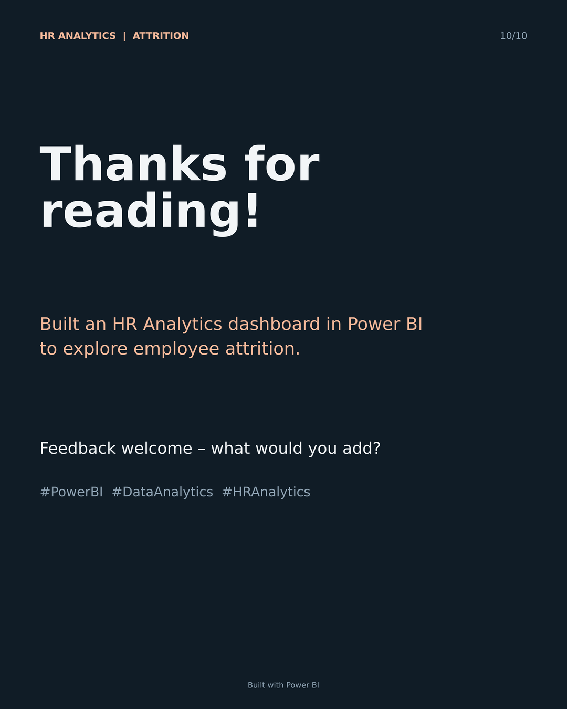</td>
  </tr>
</table>

📄 Full carousel: [HR_Attrition_Carousel.pdf](HR_Attrition_Carousel.pdf)

---

## 🛠️ Tools Used


---

## 🗃️ Dataset

- 📦 **Source:** _add your dataset source here_
- 🔢 **Size:** 1,470 employee records
- 📝 **Note:** This project uses sample data for learning and portfolio purposes.

---

## ▶️ How to Use

1. 📥 Download or clone this repository.
2. 📂 Open the `.pbix` file in **Power BI Desktop**.
3. 🖱️ Use the filters and the left menu to explore the pages.

---

## 📁 Project Structure

```
📦 HR-Analytics-Dashboard
 ┣ 📂 images
 ┃ ┣ 📂 carousel            # Carousel slide previews
 ┃ ┣ 🖼️ dashboard_v1.png    # Old dashboard
 ┃ ┗ 🖼️ dashboard_v2.png    # New dashboard
 ┣ 📊 HR_Analytics_Dashboard.pbix   # Power BI report
 ┣ 📄 HR_Attrition_Carousel.pdf     # LinkedIn carousel
 ┗ 📝 README.md
```
_Rename the `.pbix` file above to match yours._

---

## 👤 Author

<div align="center">

### **M. Naga Venkat**

[](https://www.linkedin.com/in/naga-venkat-meda-783813300/)

🤝 If you found this useful, feel free to connect and share your feedback.

⭐ Star this repo if you liked it!

</div>
